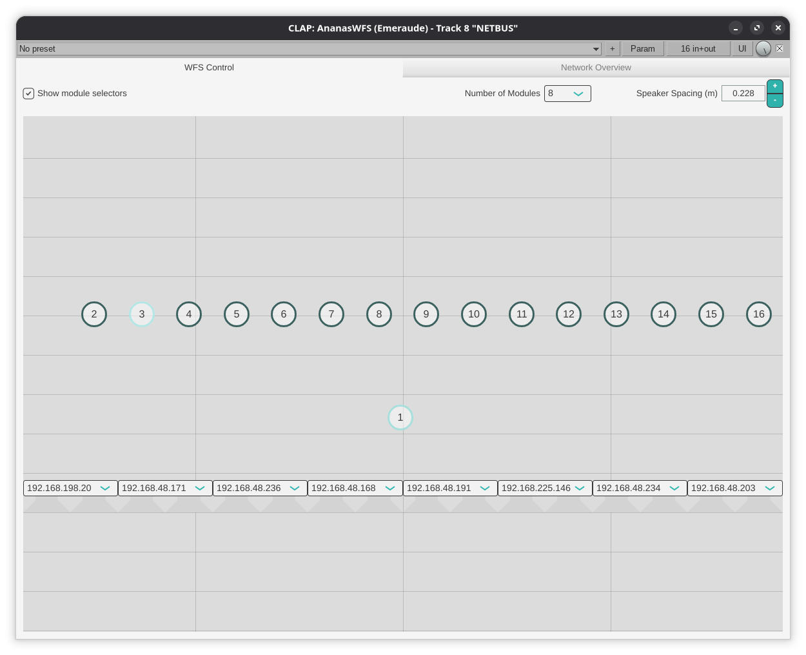
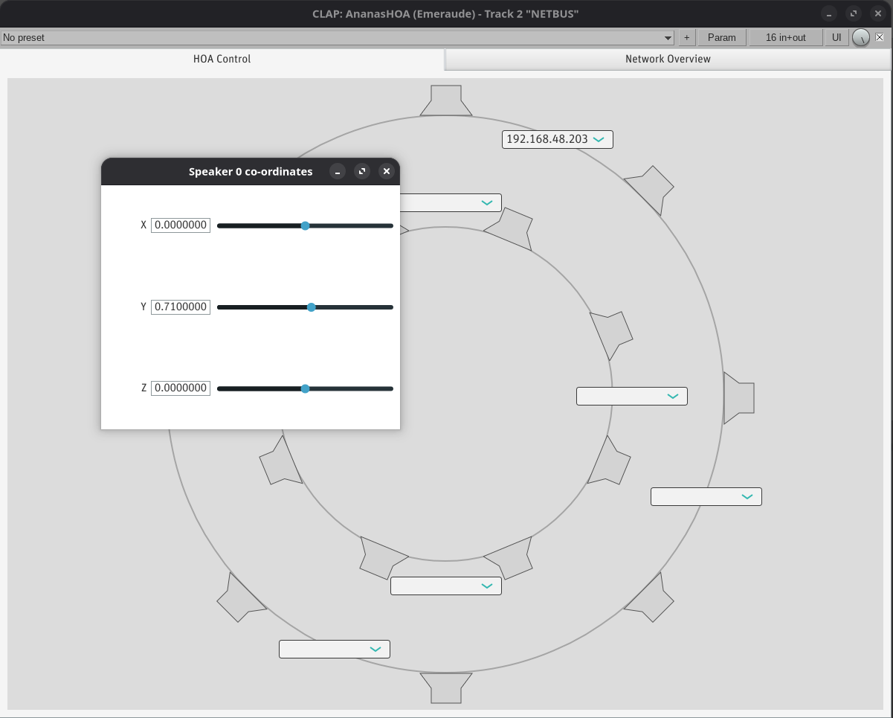

# Ananas Server

> _Ananas necessitates another networked audio system_

## Why?

Because existing systems, such as _JackTrip_ and _Audio Over OSC_, either do not
support multicast transmission, or were not designed with time-sensitive (i.e. 
sub-microsecond sync) applications in mind, nor those that entail distributed
signal processing.

Ananas exists with the aim of being a lightweight, multicast, _time-sensitive_
audio system for local area networks.

Currently certain low-level networking operations are Linux-only; support for
other operating systems may follow in due course.

## Dependencies

- JUCE 8.0.6 (included as a submodule)
- clap-juce-extensions (also included as a submodule)
- Eigen (another submodule)
- cmake 3.30
- libcurl (Arch/Manjaro `sudo pacman -Syu curl`, Ubuntu
  `sudo apt-get install libcurl-dev` (or `libcurlpp-dev`))

Additionally, in order for Ananas to read timestamps from PTP follow-up packets
(on port 320) it may be necessary to change what `sysctl` deems an 
"unprivileged" port.

```shell
sysctl net.ipv4.ip_unprivileged_port_start
```
If running that command returns a higher number than 320, add the following line
to a file in `/etc/system.d/` or `/etc/systemd/`

```shell
net.ipv4.ip_unprivileged_port_start=0 # or some number lower than 320
```

## Clone

When cloning, be sure to get all submodules recursively:

```shell
git clone --recurse-submodules https://github.com/hatchjaw/ananas 
```

## Configure & build

Most straightforward is to use CLion, or VSCode with the _CMake Tools_ 
extension.

However, from the commandline, configure with:

```shell
cmake -DCMAKE_BUILD_TYPE=(Debug|Release) -DCMAKE_MAKE_PROGRAM=ninja -G Ninja -B cmake-build-(debug|release)
```
Then build. For instance for the ananasWFS_CLAP target:

```shell
cmake --build cmake-build-(debug|release) --target ananasWFS_CLAP -j 18
```
In this instance, the build process will automatically install the .clap plugin
to an appropriate directory (typically `~/.clap/`).

## Hardware setup

The machine running a plugin (or standalone) must be connected to an 
appropriately configured ethernet switch. The ethernet interface should be 
configured manually, i.e. _without DHCP_ as follows:

- Address: 192.168.10.10
- Subnet mask: 255.255.0.0
- Gateway: 192.168.10.x

where 'x' is the last octet of the IP address assigned to the switch.

## Deliverables

### `ananas_console`

A basic commandline application that embeds the `ananas_server` library.

#### Usage

```shell
ananas_console [-f |--file=][filename]
```

Transmits two channeels of `filename` (.wav, .aif) to the network on UDP 
multicast IP `224.4.224.4`, port `41952`.

### ananasServer

A CLAP DAW plugin (and standalone application) that embeds `ananas-server` and, 
as with `ananas_console`, transmits two channels of audio data to 
`224.4.224.4:49152`. Provides functionality for monitoring (and basic management
of) connected switches, the connected time authority, and connected clients.

### ananasWFS



A CLAP DAW plugin that embeds `ananas_server`, and controls a distributed WFS
algorithm. It transmits sixteen channels of audio data, representing wave field 
synthesis (WFS) sound sources, and controls a distributed WFS algorithm running 
on a network of embedded devices.
See associated repository [ananas-client](https://github.com/hatchjaw/ananas-client).

The plugin is best added to a channel in your DAW that is set up to receive from
up to sixteen other channels.

Use the *Number of Modules* dropdown menu to set the number of available DSP 
modules; the user interface will be updated accordingly. Press the `m` key to
toggle visibility of the module selectors. The speaker spacing numeric entry box
should be used to set the distance between speaker drivers in your WFS setup.
Numeric keys can be used to expand each dropdown list of modules' IP addresses.
Assigning a module to a position in the array will trigger the transmission of
the Cartesian coordinates of the two secondary sources associated with that 
module. The positions of virtual/focused sources are represented by the numbered
nodes; right-click on a node to reveal a menu that allows you to hide/show that
node.

### ananasHOA



A CLAP DAW plugin that embeds `ananas_server`, and controls a distributed third
order HOA algorithm. It expects to receive 16 channels of ACN-encoded audio and
transmits these channels to the network to be received by a network of embedded
devices. See associated repository [ananas-client](https://github.com/hatchjaw/ananas-client).

Click on a speaker icon to reveal a modal window in which that speaker's
Cartesian coordinates can be entered. Assign a module to a pair of loudspeakers
using one of the dropdown menus to trigger the computation of the HOA decoder
matrix and the transmission of two rows of that matrix to the selected module.
As with the WFS plugin, numeric keys can be used to reveal the associated
dropdown list of available modules.
